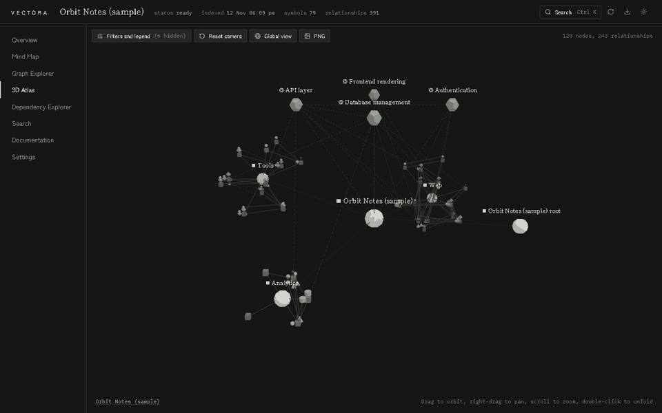
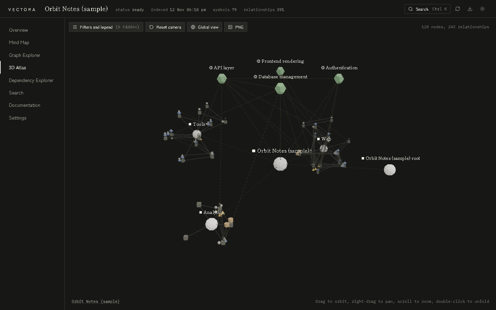
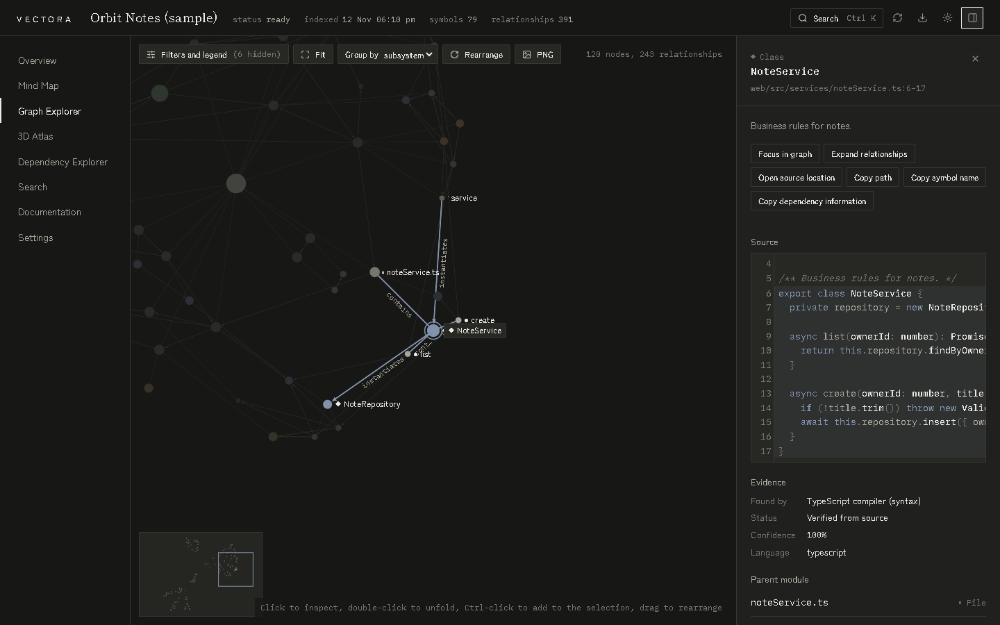
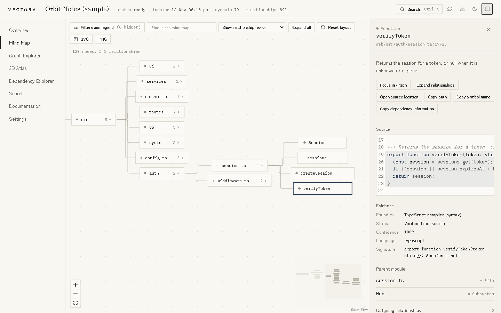
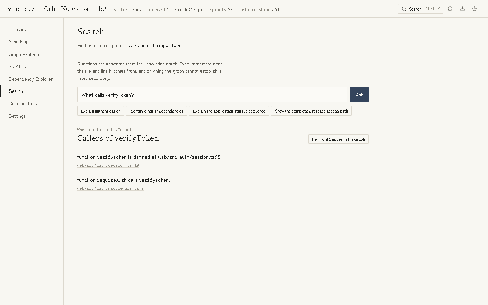
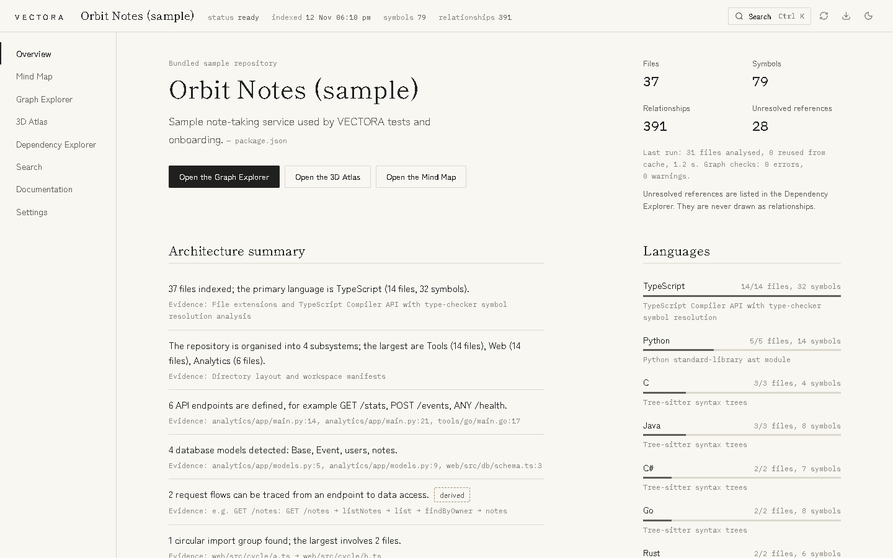
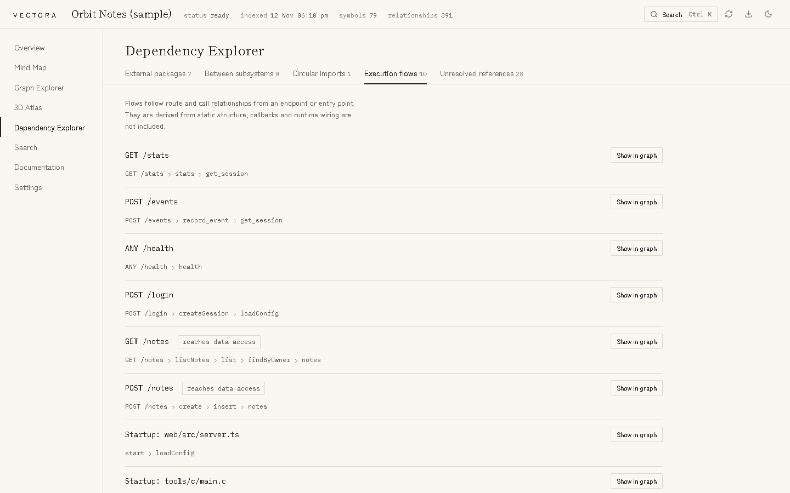
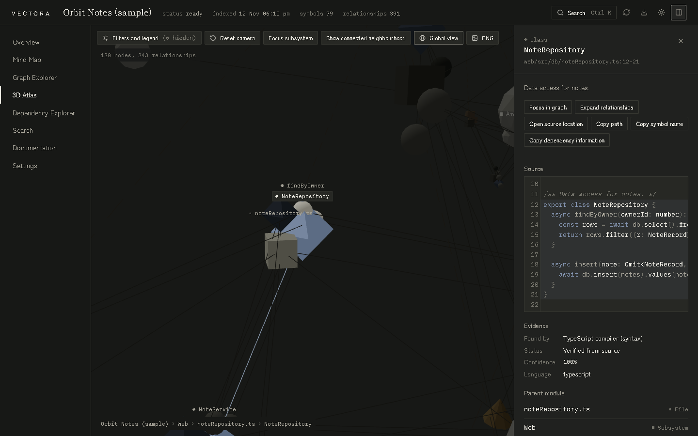
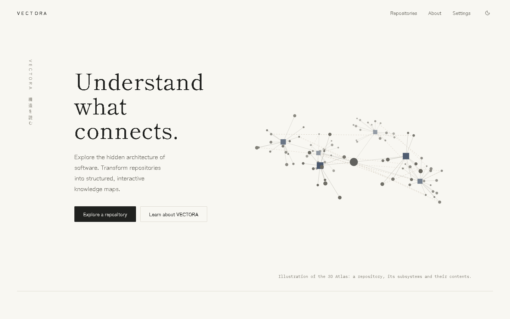

<div align="center">

# VECTORA

### Understand what connects.

Turn any software repository into a knowledge graph you can walk through —<br>
in two dimensions, in three, or as a mind map. Everything runs on your machine.

[](https://github.com/shrenixcodes/VECTORA/actions/workflows/ci.yml)


<br>



<sub>Recorded from the real application on the bundled sample repository. Nothing is staged.</sub>

</div>

<br>

## What it does

VECTORA is a codebase intelligence platform that transforms software repositories into structured, interactive knowledge maps. It reveals how components, modules, dependencies and concepts connect, giving developers a new way to understand complex software systems.

Point it at a **GitHub repository**, a **ZIP archive** or a **local folder**. It parses the source, works out what calls what, what imports what and where requests end up, and keeps the line of code that proves each relationship. Then you explore.

<br>

## Three views, one graph

Select something in one view and the other two follow.

<table>
<tr>
<td width="50%" valign="top">

### 3D Atlas

The repository at the centre, subsystems around it, files and symbols inside their subsystem, concepts above. Orbit, fly to a node, unfold it, return to the whole.

</td>
<td width="50%">

</td>
</tr>
<tr>
<td width="50%">

</td>
<td width="50%" valign="top">

### Graph Explorer

Pan and zoom a two-dimensional map. Selecting a node lights up what it depends on and what depends on it, labels each relationship, and dims the rest.

</td>
</tr>
<tr>
<td width="50%" valign="top">

### Mind Map

Subsystems, folders, files and symbols as a tree you can expand, rearrange, search and export as SVG or PNG.

</td>
<td width="50%">

</td>
</tr>
</table>

<br>

## Every claim comes with evidence



- **Ask in plain words.** “What calls `verifyToken`?”, “What could be affected if I change this class?”, “Trace `GET /notes`”, “Identify circular dependencies”. Every statement in the answer cites the file and line it comes from.
- **Open any relationship** in the inspector to see the exact line of source behind it, how it was found, and with what confidence.
- **Nothing is guessed.** A reference is linked to a definition only when there is scope evidence for it. Everything else is listed as unresolved instead of being drawn.
- **Facts and interpretation are kept apart.** Groupings such as concepts are marked as derived and drawn with dashed lines.

<br>

## More to look at

<table>
<tr>
<td width="50%">

<p align="center"><sub><b>Overview</b> — architecture summary, languages, entry points, subsystems</sub></p>
</td>
<td width="50%">

<p align="center"><sub><b>Dependency Explorer</b> — packages, cycles, flows, unresolved references</sub></p>
</td>
</tr>
<tr>
<td width="50%">

<p align="center"><sub><b>Focus</b> — fly to a symbol; the breadcrumb shows where you are</sub></p>
</td>
<td width="50%">

<p align="center"><sub><b>Light and dark themes</b> — a quiet, editorial interface</sub></p>
</td>
</tr>
</table>

<br>

## Get started in three steps

You need [Node.js](https://nodejs.org) 22.13 or newer. Python 3.8 or newer is needed only if you want Python code analysed.

**1. Get the code and install**

```bash
git clone https://github.com/shrenixcodes/VECTORA.git
```

```bash
cd VECTORA
```

```bash
npm install
```

**2. Build and start**

```bash
npm run build
```

```bash
npm start
```

**3. Open it**

Go to **<http://localhost:4317>**, choose **Explore a repository**, then **Index the sample repository**. In a few seconds you are inside “Orbit Notes”, a small multi-language sample that ships with VECTORA for exactly this purpose.

When you are ready, import your own code from the same screen.

> **Tip.** Press <kbd>Ctrl</kbd> + <kbd>K</kbd> (<kbd>Cmd</kbd> + <kbd>K</kbd> on macOS) anywhere in a workspace to search files, symbols, concepts and documentation.

<br>

## Importing your own repository

| Source | How |
|---|---|
| **GitHub** | Paste the URL, choose **Check repository**, pick a branch and optionally a subdirectory. For a private repository add an access token in the *Private repository* section — never in the URL. |
| **ZIP archive** | Drop the file. VECTORA checks it before extracting anything and lets you pick the project root. |
| **Local folder** | Type a path or choose **Browse**. The folder is read in place; nothing is copied or changed. |

`.gitignore` files are respected. Dependencies are never installed and nothing in the repository is ever run.

<br>

## Features

| | |
|---|---|
| **Exploration** | 2D Graph Explorer, 3D Atlas, Mind Map, with shared selection, focus mode, filters and saved layouts |
| **Inspector** | Original source, incoming and outgoing relationships, evidence, parent module, related concepts |
| **Search** | Command palette, type filters, documentation search |
| **Questions** | Callers, dependents, impact of a change, traces, data access paths, cycles, startup sequence |
| **Dependencies** | External packages, subsystem dependencies, circular imports, execution flows, unresolved references |
| **Indexing** | Incremental; unchanged files are reused; analysis runs in worker threads |
| **Exports** | Graph as JSON or GraphML; mind map as SVG or PNG; views as PNG; analysis and architecture documents as Markdown |
| **Workspace** | Selection, filters, layouts and view are saved and restored automatically |
| **Accessibility** | Keyboard access, visible focus, reduced-motion support, colour never the only signal |

<br>

## Supported languages

| Language | Tier | How it is analysed |
|---|:-:|---|
| TypeScript, JavaScript | 1 | TypeScript Compiler API; references resolved by the type checker |
| Python | 1 | Standard-library `ast`; imports and scope resolved by the indexer |
| Java, Go, Rust, C, C++, C# | 2 | Tree-sitter syntax trees; imports and scope resolved by the indexer |

Files in other languages are indexed as files and are searchable, but are not analysed at symbol level. Every repository shows its own language coverage. VECTORA does not claim to support every language.

<br>

## Your code stays on your machine

- Indexing, the graph database and search all run in a local engine. **No source code is uploaded.**
- The engine listens on the loopback interface only and rejects requests from other origins.
- Access tokens are stored encrypted, sent only to GitHub in a request header, and never written to logs, URLs or exports.
- Exports leave out source text unless you ask for it.
- No telemetry, no account.

Everything VECTORA stores lives in one folder, `.vectora-data` inside the VECTORA folder by default. Set `VECTORA_DATA_DIR` to move it; see [`.env.example`](.env.example). Details are in [docs/SECURITY.md](docs/SECURITY.md).

<br>

## How it works

```
repository ─► discovery ─► syntax analysis ─► relationship resolution ─► flows ─► organisation ─► knowledge graph
                                                                                                       │
                                              Graph Explorer  ◄──┐                                     ▼
                                              3D Atlas        ◄──┼── one graph, one selection ◄── local SQLite
                                              Mind Map        ◄──┘
```

```
apps/
  local-engine/        Fastify service: imports, indexing jobs, graph API, exports
  web/                 React application: landing, import, workspace, three views
packages/
  graph-schema/        Node and relationship types, validation
  language-adapters/   TypeScript, Python and Tree-sitter adapters behind one interface
  repository-indexer/  Scanning, resolution, organisation, worker pool
  graph-engine/        Algorithms, SQLite store, exports, question exploration
  graph-layout/        3D and 2D layout engines
  search/              Search index
  shared/              Settings schema, API contracts
```

More in [docs/ARCHITECTURE.md](docs/ARCHITECTURE.md).

<br>

## Development

```bash
npm run dev
```

starts the engine and the web application with reloading; open <http://localhost:5173>.

| Command | Purpose |
|---|---|
| `npm test` | Unit and integration tests |
| `npm run test:e2e` | Browser journeys against the production build (run `npm run build` first) |
| `npm run typecheck` / `npm run lint` | Static checks |
| `npm run bench` | Performance benchmarks |
| `npx tsx scripts/screenshots.ts --record` | Re-create the screenshots and the tour in this README |

Current state: 79 unit and integration tests and 18 browser journeys pass. On the development machine a 10,000-file synthetic repository indexed in 31 seconds with a warm file cache (54 seconds cold). Results, coverage and what is not yet tested are in [docs/TESTING.md](docs/TESTING.md) and [docs/PERFORMANCE.md](docs/PERFORMANCE.md).

<br>

## Documentation

| | |
|---|---|
| [User guide](docs/USER_GUIDE.md) | Importing, exploring, exporting |
| [Architecture](docs/ARCHITECTURE.md) | Components and how they interact |
| [Data model](docs/DATA_MODEL.md) | Every node and relationship type |
| [Indexing pipeline](docs/INDEXING_PIPELINE.md) | Scanning, parsing, resolution, organisation |
| [Graph engine](docs/GRAPH_ENGINE.md) | Persistence and algorithms |
| [Visualisation](docs/VISUALIZATION.md) | 2D, 3D and mind map rendering |
| [Design system](docs/DESIGN_SYSTEM.md) | Typography, colour, spacing, motion |
| [Security](docs/SECURITY.md) | Threat model and protections |
| [Performance](docs/PERFORMANCE.md) | Benchmarks and optimisation decisions |
| [Testing](docs/TESTING.md) | Commands, results, coverage |
| [Troubleshooting](docs/TROUBLESHOOTING.md) | Common problems and fixes |
| [Contributing](docs/CONTRIBUTING.md) | Setup and guidelines |
| [Roadmap](docs/ROADMAP.md) · [Changelog](docs/CHANGELOG.md) · [Licences](docs/LICENSES.md) | |

Project records: [status](PROJECT_STATUS.md), [checklist](IMPLEMENTATION_CHECKLIST.md), [decisions](DECISIONS.md), [known issues](KNOWN_ISSUES.md).

<br>

## Status and limits

Version 0.1.0 is the first release. It has been developed and tested on Windows 11 with Microsoft Edge; macOS, Linux and other browsers are untested. There is no packaged desktop application yet. The full list of limitations is in [KNOWN_ISSUES.md](KNOWN_ISSUES.md).

## License

MIT. See [LICENSE](LICENSE). Third-party licences are listed in [docs/LICENSES.md](docs/LICENSES.md).

<br>

<div align="center">

**VECTORA**<br>
Understand what connects.

</div>
